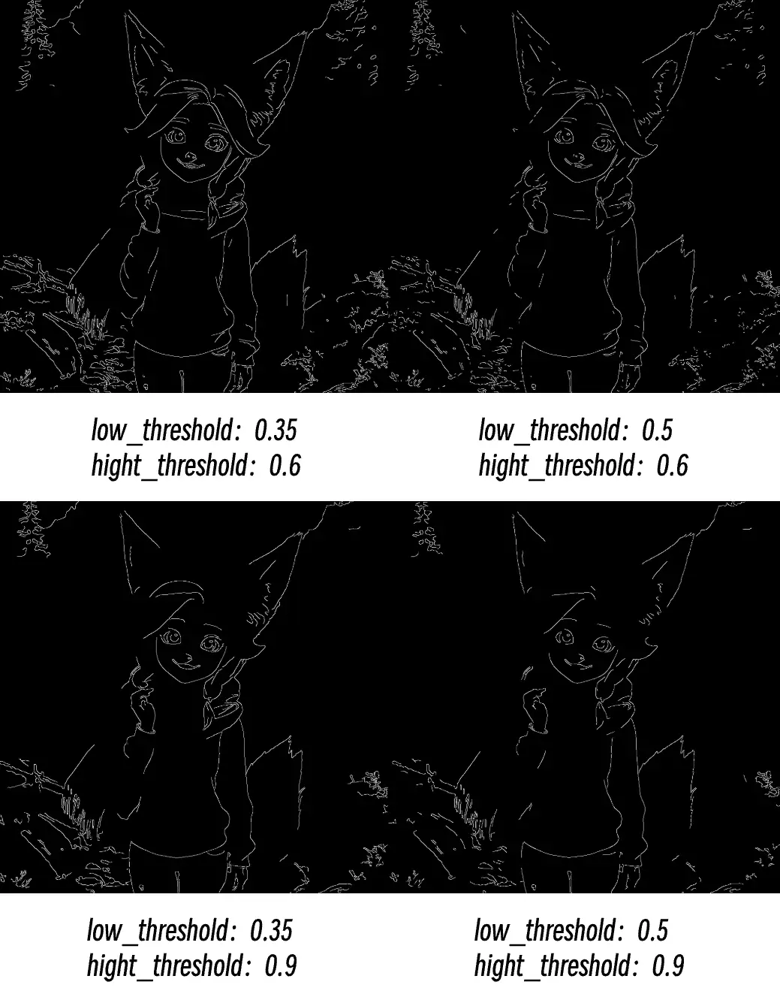

# Canny

Extrahiert alle Kantenlinien aus Fotos, ähnlich dem Nachzeichnen eines Fotos mit einem Stift, wodurch Konturen und Detailgrenzen von Objekten herausgearbeitet werden.

## Funktionsprinzip

Stellen Sie sich vor, Sie sind ein Künstler und müssen ein Foto mit einem Stift nachzeichnen. Der Canny-Node fungiert dabei wie ein intelligenter Assistent, der Ihnen hilft zu entscheiden, wo Linien (Kanten) gezeichnet werden sollen und wo nicht.

Dieser Prozess ähnelt einem Auswahlverfahren:

- **Hoher Schwellenwert** ist die Regel „Linie muss gezeichnet werden“: Nur sehr deutliche und klare Konturlinien werden gezeichnet, beispielsweise Gesichtskonturen von Personen und Gebäuderahmen
- **Niedriger Schwellenwert** ist die Regel „Linie darf auf keinen Fall gezeichnet werden“: Zu schwache Kanten werden ignoriert, um Rauschen und bedeutungslose Linien zu vermeiden
- **Mittlerer Bereich**: Kanten zwischen den beiden Schwellenwerten werden mitgezeichnet, wenn sie mit „muss gezeichnet werden“-Linien verbunden sind; isolierte Kanten werden nicht gezeichnet

Das endgültige Ergebnis ist ein Schwarz-Weiß-Bild, in dem weiße Bereiche die erkannten Kantenlinien und schwarze Bereiche Flächen ohne Kanten sind.

## Eingaben

| Parametername | Funktionsbeschreibung | Datentyp | Eingabetyp | Standard | Bereich |
| --- | --- | --- | --- | --- | --- |
| `image` | Originalfoto, aus dem Kanten extrahiert werden sollen | IMAGE | Eingabe | - | - |
| `low_threshold` | Niedriger Schwellenwert; bestimmt, wie schwache Kanten ignoriert werden. Niedrigere Werte bewahren mehr Details, können aber Rauschen erzeugen | FLOAT | Widget | 0.4 | 0.01-0.99 |
| `high_threshold` | Hoher Schwellenwert; bestimmt, wie starke Kanten erhalten bleiben. Höhere Werte behalten nur die offensichtlichsten Konturlinien bei | FLOAT | Widget | 0.8 | 0.01-0.99 |

## Ausgaben

| Ausgabename | Beschreibung | Datentyp |
| --- | --- | --- |
| `image` | Schwarz-Weiß-Kantenbild; weiße Linien sind erkannte Kanten, schwarze Bereiche sind Flächen ohne Kanten | IMAGE |

## Parametervergleich

**Häufige Probleme:**

- Unterbrochene Kanten: Versuchen Sie, den hohen Schwellenwert zu verringern
- Zu viel Rauschen: Erhöhen Sie den niedrigen Schwellenwert
- Fehlende wichtige Details: Verringern Sie den niedrigen Schwellenwert
- Kanten zu grob: Prüfen Sie die Qualität und Auflösung des Eingabebilds

> Diese Dokumentation wurde von KI generiert. Wenn Sie Fehler finden oder Verbesserungsvorschläge haben, tragen Sie gerne dazu bei! [Auf GitHub bearbeiten](https://github.com/Comfy-Org/embedded-docs/blob/main/comfyui_embedded_docs/docs/Canny/de.md)
