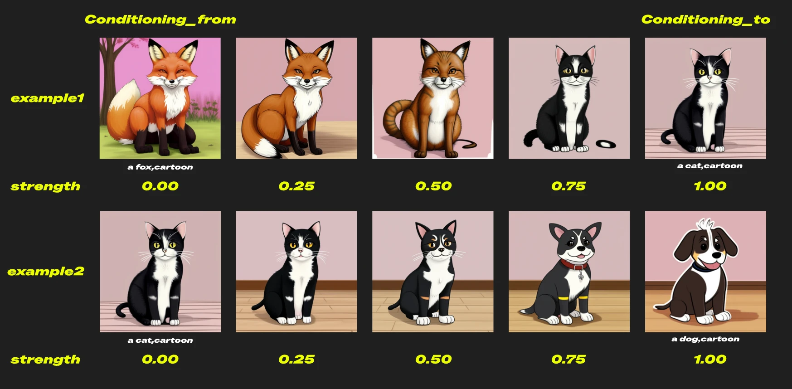

# Conditioning (Media)

Il nodo `ConditioningAverage` viene utilizzato per fondere due diversi set di conditioning (come prompt testuali) in base a un peso specificato, generando un nuovo vettore di conditioning intermedio tra i due. Regolando il parametro del peso, è possibile controllare in modo flessibile l'influenza di ciascun conditioning sul risultato finale. È particolarmente adatto per l'interpolazione dei prompt, la fusione di stili e altri casi d'uso avanzati.

Come mostrato di seguito, regolando la forza di `conditioning_to`, è possibile ottenere un risultato intermedio tra i due conditioning.

## Input

| Parametro | Descrizione | Comfy dtype |
| --- | --- | --- |
| `conditioning_to` | Il vettore di conditioning di destinazione, che funge da base principale per la media ponderata. | `CONDITIONING` |
| `conditioning_from` | Il vettore di conditioning di origine, che verrà fuso nel target in base a un determinato peso. | `CONDITIONING` |
| `conditioning_to_strength` | La forza del conditioning di destinazione, intervallo 0.0-1.0, valore predefinito 1.0, passo 0.01. | `FLOAT` |

## Output

| Parametro | Descrizione | Comfy dtype |
| --- | --- | --- |
| `conditioning` | Il vettore di conditioning risultante dopo la fusione, che riflette la media ponderata. | `CONDITIONING` |

## Casi d'uso tipici

- **Interpolazione dei prompt:** Passa in modo fluido tra due prompt testuali diversi, generando contenuti con stile o semantica intermedi.
- **Fusione di stili:** Combina stili artistici o condizioni semantiche diversi per creare effetti nuovi.
- **Regolazione della forza:** Controlla con precisione l'influenza di un particolare conditioning sul risultato regolando il peso.
- **Esplorazione creativa:** Esplora diversi effetti generativi mescolando prompt differenti.

> Questa documentazione è stata generata dall'IA. Se trovi errori o hai suggerimenti per migliorarla, sentiti libero di contribuire! [Modifica su GitHub](https://github.com/Comfy-Org/embedded-docs/blob/main/comfyui_embedded_docs/docs/ConditioningAverage/it.md)
