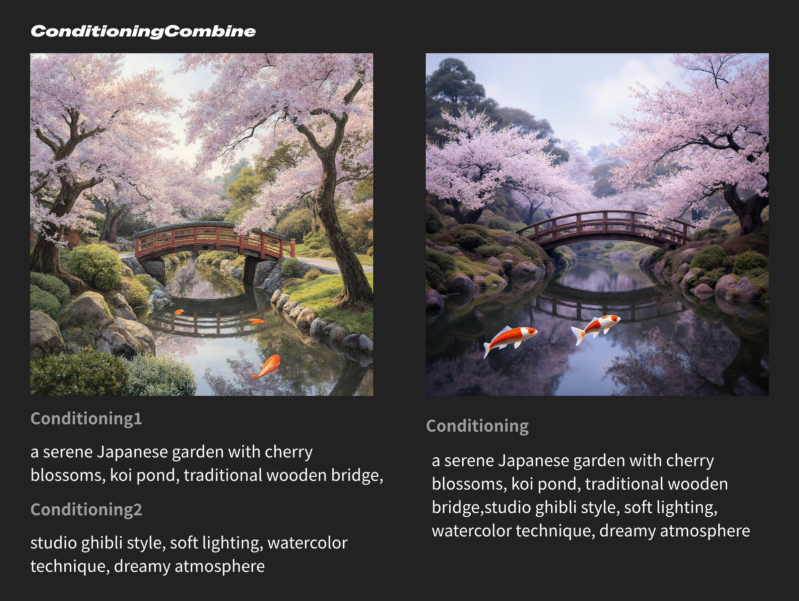

# התניה (שילוב)

צומת זה משלב שני קלטי קונדישנינג לפלט יחיד, ובכך ממזג למעשה את המידע שלהם. שני התנאים משולבים באמצעות שרשור רשימות.

## קלטים

| שם פרמטר | תיאור | סוג נתונים |
| --- | --- | --- |
| `conditioning_1` | קלט הקונדישנינג הראשון שיש לשלב. יש לו חשיבות שווה ל-`conditioning_2` בתהליך השילוב. | `CONDITIONING` |
| `conditioning_2` | קלט הקונדישנינג השני שיש לשלב. יש לו חשיבות שווה ל-`conditioning_1` בתהליך השילוב. | `CONDITIONING` |

## פלטים

| שם פרמטר | תיאור | סוג נתונים |
| --- | --- | --- |
| `conditioning` | התוצאה של שילוב `conditioning_1` ו-`conditioning_2`, העוטפת את המידע הממוזג. | `CONDITIONING` |

## תרחישי שימוש

השוו בין שתי הקבוצות שלמטה: הצד השמאלי משתמש בצומת ConditioningCombine, בעוד הצד הימני מציג פלט רגיל.

בדוגמה זו, לשני התנאים המשמשים ב-`Conditioning Combine` יש חשיבות שקולה. לכן, ניתן להשתמש בקידודי טקסט שונים עבור סגנון תמונה, מאפייני נושא וכו', מה שמאפשר להפיק את מאפייני הפרומפט בצורה מלאה יותר. הפרומפט השני משתמש בפרומפט המשולב המלא, אך הבנה סמנטית עשויה לקודד תנאים שונים לחלוטין.

באמצעות צומת זה, ניתן להשיג:

- מיזוג טקסט בסיסי: חברו את הפלטים של שני צמתי `CLIP Text Encode` לשני פורטי הקלט של `Conditioning Combine`
- שילוב פרומפטים מורכב: שלבו פרומפטים חיוביים ושליליים, או קודדו בנפרד תיאורים ראשיים ותיאורי סגנון לפני המיזוג
- שילוב בשרשרת תנאים: ניתן להשתמש במספר צמתי `Conditioning Combine` בסדרה כדי להשיג שילוב הדרגתי של מספר תנאים

> מסמך זה נוצר על ידי בינה מלאכותית. אם מצאתם שגיאות או שיש לכם הצעות לשיפור, אתם מוזמנים לתרום! [עריכה ב-GitHub](https://github.com/Comfy-Org/embedded-docs/blob/main/comfyui_embedded_docs/docs/ConditioningCombine/he.md)
