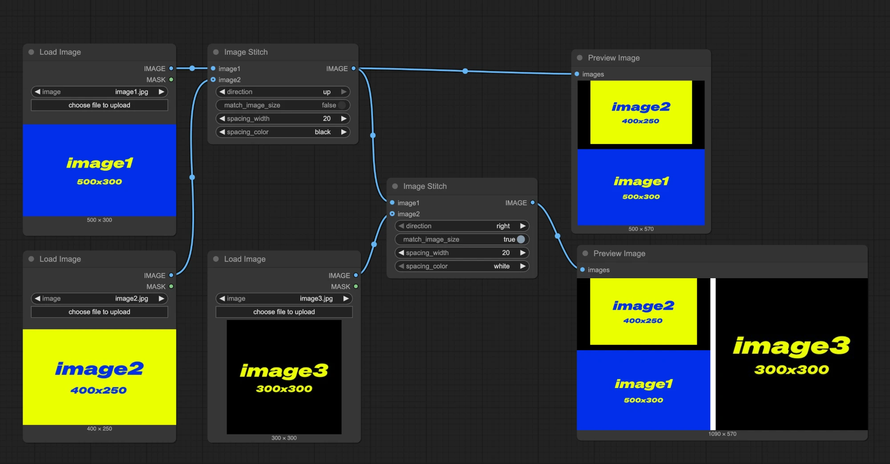
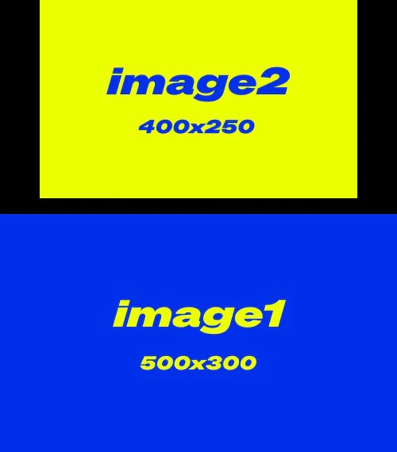
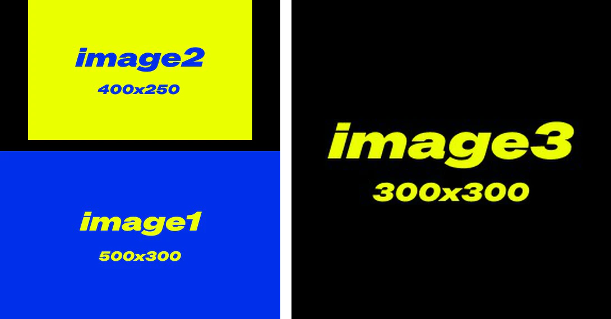

# ImageStitch

Dieser Node ermöglicht es Ihnen, zwei Bilder in einer angegebenen Richtung (oben, unten, links, rechts) zusammenzufügen, mit Unterstützung für Größenanpassung und Abstand zwischen den Bildern.

## Eingaben

| Parametername | Beschreibung | Datentyp | Eingabetyp | Standard | Bereich |
| --- | --- | --- | --- | --- | --- |
| `image1` | Das erste Bild, das zusammengefügt werden soll | IMAGE | Erforderlich | - | - |
| `image2` | Das zweite Bild, das zusammengefügt werden soll; wenn nicht angegeben, wird nur das erste Bild zurückgegeben | IMAGE | Optional | None | - |
| `direction` | Die Richtung zum Zusammenfügen des zweiten Bildes: right, down, left oder up | STRING | Erforderlich | right | right/down/left/up |
| `match_image_size` | Ob die Größe des zweiten Bildes angepasst werden soll, damit es den Abmessungen des ersten Bildes entspricht | BOOLEAN | Erforderlich | True | True/False |
| `spacing_width` | Breite des Abstands zwischen den Bildern; muss eine gerade Zahl sein | INT | Erforderlich | 0 | 0-1024 |
| `spacing_color` | Farbe des Abstands zwischen zusammengefügten Bildern | STRING | Erforderlich | white | white/black/red/green/blue |

> Bei `spacing_color`: Wenn andere Farben als "white/black" verwendet werden und `match_image_size` auf `false` gesetzt ist, wird der Padding-Bereich mit black gefüllt

## Ausgaben

| Ausgabename | Beschreibung | Datentyp |
| --- | --- | --- |
| `IMAGE` | Das zusammengefügte Bild | IMAGE |

## Workflow-Beispiel

Im folgenden Workflow verwenden wir 3 Eingabebilder unterschiedlicher Größe als Beispiele:

- image1: 500x300
- image2: 400x250
- image3: 300x300

**Erster Image-Stitch-Node**

- `match_image_size`: false, die Bilder werden in ihren Originalgrößen zusammengefügt
- `direction`: up, `image2` wird über `image1` platziert
- `spacing_width`: 20
- `spacing_color`: black

Ausgabebild 1:

**Zweiter Image-Stitch-Node**

- `match_image_size`: true, das zweite Bild wird skaliert, um der Höhe oder Breite des ersten Bildes zu entsprechen
- `direction`: right, `image3` erscheint auf der rechten Seite
- `spacing_width`: 20
- `spacing_color`: white

Ausgabebild 2:

> Diese Dokumentation wurde von KI generiert. Wenn Sie Fehler finden oder Verbesserungsvorschläge haben, tragen Sie gerne dazu bei! [Auf GitHub bearbeiten](https://github.com/Comfy-Org/embedded-docs/blob/main/comfyui_embedded_docs/docs/ImageStitch/de.md)
