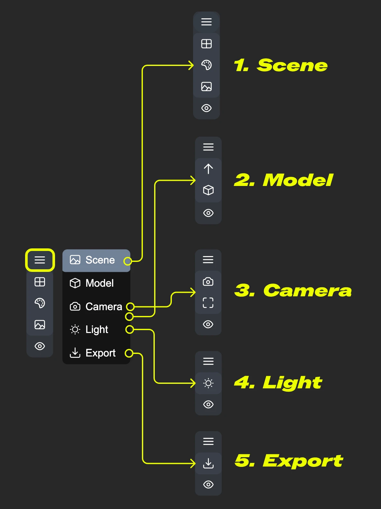
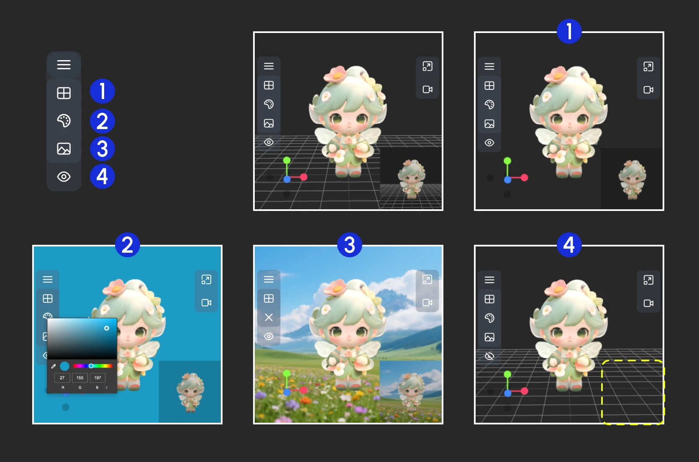
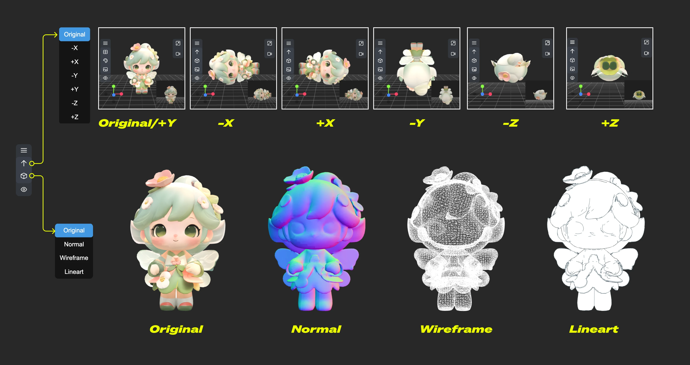
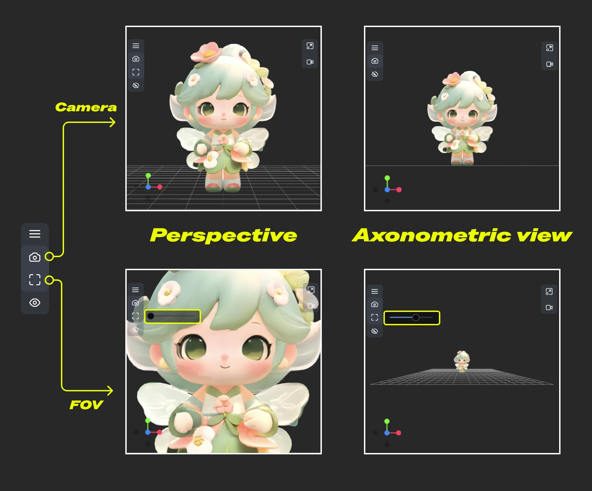
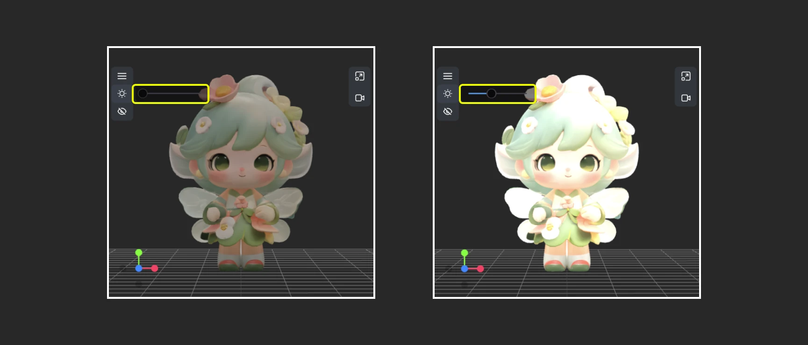
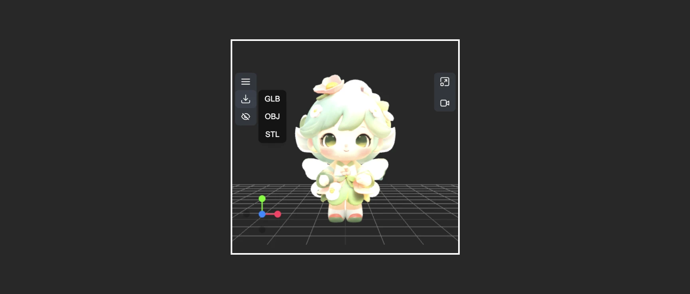

# Load3D

Der Load3D-Node ist ein Kern-Node zum Laden und Verarbeiten von 3D-Modell-Dateien. Beim Laden des Nodes ruft er automatisch verfügbare 3D-Ressourcen aus `ComfyUI/input/3d/` ab. Sie können außerdem unterstützte 3D-Dateien über die Upload-Funktion zur Vorschau hochladen.

**Unterstützte Formate**
Derzeit unterstützt dieser Node mehrere 3D-Dateiformate, darunter `.gltf`, `.glb`, `.obj`, `.fbx` und `.stl`.

**3D-Node-Einstellungen**
Einige zugehörige Einstellungen für 3D-Nodes können im Einstellungsmenü von ComfyUI konfiguriert werden. Weitere Informationen zu den entsprechenden Einstellungen finden Sie in der folgenden Dokumentation:

[Einstellungsmenü](https://docs.comfy.org/interface/settings/3d)

Neben regulären Node-Ausgaben verfügt Load3D über viele Einstellungen für die 3D-Ansicht im Canvas-Menü.

## Eingaben

| Parametername | Beschreibung | Typ | Standard | Bereich |
| --- | --- | --- | --- | --- |
| model_file | Pfad zur 3D-Modell-Datei, unterstützt Upload, liest standardmäßig Modelldateien aus `ComfyUI/input/3d/` | Dateiauswahl | - | Unterstützte Formate |
| width | Canvas-Renderbreite | INT | 1024 | 1-4096 |
| height | Canvas-Renderhöhe | INT | 1024 | 1-4096 |

## Ausgaben

| Parametername | Beschreibung | Datentyp |
| --- | --- | --- |
| image | Von der Canvas gerendertes Bild | IMAGE |
| mask | Maske, die die aktuelle Modellposition enthält | MASK |
| mesh_path | Pfad zur Modelldatei | STRING |
| normal | Normal Map | IMAGE |
| lineart | Line-Art-Bildausgabe; der entsprechende `edge_threshold` kann im Canvas-Modellmenü angepasst werden | IMAGE |
| camera_info | Kamerainformationen | LOAD3D_CAMERA |
| recording_video | Aufgezeichnetes Video (nur wenn eine Aufzeichnung vorhanden ist) | VIDEO |

Vorschau aller Ausgaben:

## Beschreibung des Canvas-Bereichs

Der Canvas-Bereich des Load3D-Nodes enthält zahlreiche Ansichtsoperationen, darunter:

- Vorschauansicht-Einstellungen (Raster, Hintergrundfarbe, Vorschauansicht)
- Kamerasteuerung: FOV und Kameratyp steuern
- Globale Beleuchtungsintensität: Beleuchtungsintensität anpassen
- Videoaufzeichnung: Videos aufzeichnen und exportieren
- Modellexport: Unterstützt die Formate `GLB`, `OBJ`, `STL`
- Und mehr

1. Enthält mehrere Menüs und versteckte Menüs des Load 3D-Nodes
2. Menü zum `Ändern der Größe des Vorschaufensters` und für die `Canvas-Videoaufzeichnung`
3. Achse für 3D-Ansichtsoperationen
4. Vorschauminiatur
5. Einstellungen für die Vorschaugröße: Skalieren Sie die Anzeige der Vorschauansicht, indem Sie die Abmessungen festlegen und dann die Fenstergröße ändern

### 1. Ansichtsoperationen

<video controls width="640" height="360">
  <source src="https://raw.githubusercontent.com/Comfy-Org/embedded-docs/refs/heads/main/comfyui_embedded_docs/docs/Load3D/asset/view_operations.mp4" type="video/mp4">
  Ihr Browser unterstützt die Videowiedergabe nicht.
</video>

Ansichtssteuerungsoperationen:

- Linksklick + Ziehen: Ansicht drehen
- Rechtsklick + Ziehen: Ansicht verschieben
- Mausrad scrollen oder Mittelklick + Ziehen: Vergrößern/Verkleinern
- Koordinatenachse: Ansichten wechseln

### 2. Funktionen des linken Menüs

In der Canvas sind einige Einstellungen im Menü ausgeblendet. Klicken Sie auf die Menüschaltfläche, um verschiedene Menüs zu erweitern

- 1. Szene: Enthält Vorschaufenster-Raster, Hintergrundfarbe und Vorschau-Einstellungen
- 2. Modell: Modell-Rendering-Modus, Texturmaterialien und Einstellungen für die Aufwärtsrichtung
- 3. Kamera: Zwischen orthografischer und perspektivischer Ansicht wechseln und die Größe des Perspektivwinkels festlegen
- 4. Licht: Globale Beleuchtungsintensität der Szene
- 5. Export: Modell in andere Formate exportieren (GLB, OBJ, STL)

#### Szene

Das Szenenmenü bietet einige grundlegende Funktionen zur Szeneneinstellung

1. Raster ein-/ausblenden
2. Hintergrundfarbe festlegen
3. Klicken, um ein Hintergrundbild hochzuladen
4. Vorschau ausblenden

#### Modell

Das Modellmenü bietet einige modellbezogene Funktionen

1. **Aufwärtsrichtung**: Bestimmt, welche Achse die Aufwärtsrichtung für das Modell ist
2. **Materialmodus**: Wechselt die Modell-Rendering-Modi – Original, Normal, Wireframe, Lineart

#### Kamera

Dieses Menü ermöglicht das Umschalten zwischen orthografischer und perspektivischer Ansicht sowie Einstellungen für die Größe des Perspektivwinkels

1. **Kamera**: Schnell zwischen orthografischer und perspektivischer Ansicht wechseln
2. **FOV**: FOV-Winkel anpassen

#### Licht

Über dieses Menü können Sie die globale Beleuchtungsintensität der Szene schnell anpassen

#### Export

Dieses Menü bietet die Möglichkeit, Modellformate schnell zu konvertieren und zu exportieren

### 3. Funktionen des rechten Menüs

<video controls width="640" height="360">
  <source src="https://raw.githubusercontent.com/Comfy-Org/embedded-docs/refs/heads/main/comfyui_embedded_docs/docs/Load3D/asset/view_operations.mp4" type="video/mp4">
  Ihr Browser unterstützt die Videowiedergabe nicht.
</video>

Das rechte Menü hat zwei Hauptfunktionen:

1. **Ansichtsverhältnis zurücksetzen**: Nach Klicken der Schaltfläche passt die Ansicht das Rendering-Bereichsverhältnis der Canvas gemäß der festgelegten Breite und Höhe an
2. **Videoaufzeichnung**: Ermöglicht das Aufzeichnen aktueller 3D-Ansichtsoperationen als Video, erlaubt den Import und kann als `recording_video` an nachfolgende Nodes ausgegeben werden

> Diese Dokumentation wurde von KI generiert. Wenn Sie Fehler finden oder Verbesserungsvorschläge haben, tragen Sie gerne dazu bei! [Auf GitHub bearbeiten](https://github.com/Comfy-Org/embedded-docs/blob/main/comfyui_embedded_docs/docs/Load3D/de.md)
