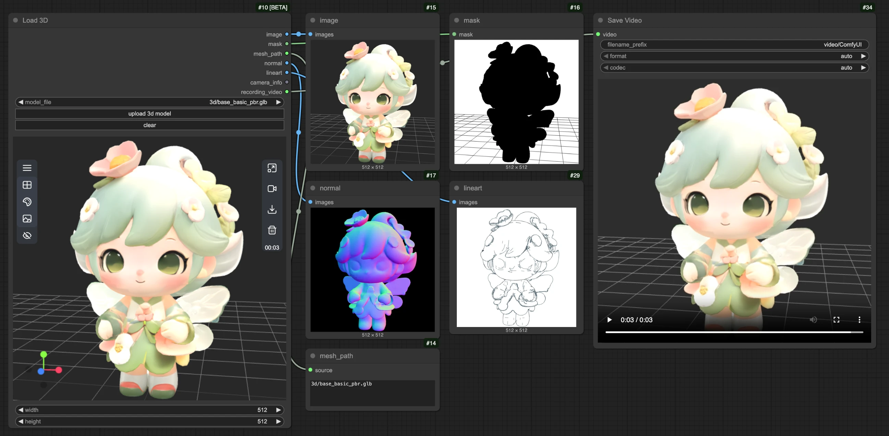
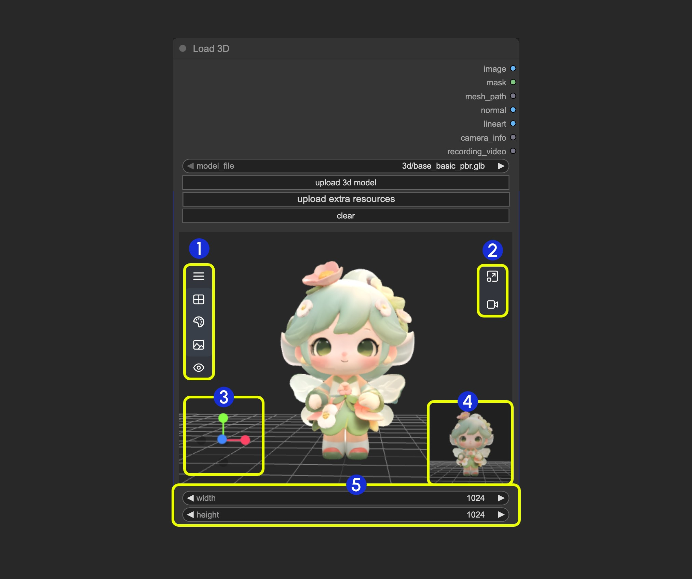

# Load3DAnimation

Der Load3DAnimation-Node ist ein Kern-Node zum Laden und Verarbeiten von 3D-Modelldateien. Beim Laden des Nodes ruft er automatisch verfügbare 3D-Ressourcen aus `ComfyUI/input/3d/` ab. Sie können auch unterstützte 3D-Dateien über die Upload-Funktion zur Vorschau hochladen.

> - Die meisten Funktionen dieses Nodes sind identisch mit dem Load 3D-Node, aber dieser Node unterstützt das Laden von Modellen mit Animationen, und Sie können die entsprechenden Animationen im Node in der Vorschau ansehen.
> - Der Inhalt dieser Dokumentation entspricht dem des Load3D-Nodes, da ihre Fähigkeiten mit Ausnahme von Animationsvorschau und -wiedergabe identisch sind.

**Unterstützte Formate**
Derzeit unterstützt dieser Node mehrere 3D-Dateiformate, darunter `.gltf`, `.glb`, `.obj`, `.fbx` und `.stl`.

**3D-Node-Einstellungen**
Einige zugehörige Einstellungen für 3D-Nodes können im Einstellungsmenü von ComfyUI konfiguriert werden. Die entsprechenden Einstellungen entnehmen Sie bitte der folgenden Dokumentation:

[Einstellungsmenü](https://docs.comfy.org/interface/settings/3d)

Neben den regulären Node-Ausgaben verfügt Load3D über viele Einstellungen für die 3D-Ansicht im Canvas-Menü.

## Eingaben

| Parametername | Beschreibung | Typ | Standard | Bereich |
| --- | --- | --- | --- | --- |
| model_file | Dateipfad des 3D-Modells, unterstützt Upload, liest standardmäßig Modelldateien aus `ComfyUI/input/3d/` | Dateiauswahl | - | Unterstützte Formate |
| width | Renderbreite des Canvas | INT | 1024 | 1-4096 |
| height | Renderhöhe des Canvas | INT | 1024 | 1-4096 |

## Ausgaben

| Parametername | Beschreibung | Datentyp |
| --- | --- | --- |
| image | Vom Canvas gerendertes Bild | IMAGE |
| mask | Maske, die die aktuelle Modellposition enthält | MASK |
| mesh_path | Dateipfad des Modells | STRING |
| normal | Normal Map | IMAGE |
| lineart | Ausgabe eines Line-Art-Bildes; der entsprechende `edge_threshold` kann im Modellmenü des Canvas angepasst werden | IMAGE |
| camera_info | Kamerainformationen | LOAD3D_CAMERA |
| recording_video | Aufgezeichnetes Video (nur wenn eine Aufnahme vorhanden ist) | VIDEO |

Vorschau aller Ausgaben:

## Beschreibung des Canvas-Bereichs

Der Canvas-Bereich des Load3D-Nodes enthält zahlreiche Ansichtsoperationen, darunter:

- Einstellungen der Vorschauansicht (Raster, Hintergrundfarbe, Vorschauansicht)
- Kamerasteuerung: FOV, Kameratyp steuern
- Intensität der globalen Beleuchtung: Beleuchtungsintensität anpassen
- Videoaufzeichnung: Videos aufzeichnen und exportieren
- Modellexport: Unterstützt die Formate `GLB`, `OBJ`, `STL`
- Und mehr

1. Enthält mehrere Menüs und versteckte Menüs des Load 3D-Nodes
2. Menü für `resizing preview window` und `canvas video recording`
3. Bedienachse der 3D-Ansicht
4. Vorschaubild
5. Einstellungen für die Vorschaugröße; skalieren Sie die Anzeige der Vorschauansicht, indem Sie die Abmessungen festlegen und dann das Fenster skalieren

### 1. Ansichtsoperationen

<video controls width="640" height="360">
  <source src="https://raw.githubusercontent.com/Comfy-Org/embedded-docs/refs/heads/main/comfyui_embedded_docs/docs/Load3D/asset/view_operations.mp4" type="video/mp4">
  Ihr Browser unterstützt die Videowiedergabe nicht.
</video>

Bedienung der Ansicht:

- Linksklick + Ziehen: Ansicht drehen
- Rechtsklick + Ziehen: Ansicht verschieben
- Mittleres Mausrad scrollen oder mittlere Maustaste + Ziehen: Hinein-/Herauszoomen
- Koordinatenachse: Ansichten wechseln

### 2. Funktionen des linken Menüs

Im Canvas sind einige Einstellungen im Menü ausgeblendet. Klicken Sie auf die Menüschaltfläche, um verschiedene Menüs zu erweitern

- 1. Szene: Enthält Vorschaufenster-Raster, Hintergrundfarbe und Vorschaueinstellungen
- 2. Modell: Modell-Renderingmodus, Texturmaterialien, Einstellungen für die Aufwärtsrichtung
- 3. Kamera: Zwischen orthografischer und perspektivischer Ansicht wechseln und die Größe des Perspektivwinkels einstellen
- 4. Licht: Intensität der globalen Szenenbeleuchtung
- 5. Export: Modell in andere Formate exportieren (GLB, OBJ, STL)

#### Szene

Das Menü „Szene“ bietet einige grundlegende Funktionen zur Szeneneinstellung

1. Raster ein-/ausblenden
2. Hintergrundfarbe festlegen
3. Klicken, um ein Hintergrundbild hochzuladen
4. Vorschau ausblenden

#### Modell

Das Menü „Modell“ bietet einige modellbezogene Funktionen

1. **Aufwärtsrichtung**: Legen Sie fest, welche Achse die Aufwärtsrichtung für das Modell ist
2. **Materialmodus**: Modell-Renderingmodi umschalten – Original, Normal, Wireframe, Lineart

#### Kamera

Dieses Menü ermöglicht das Umschalten zwischen orthografischer und perspektivischer Ansicht sowie Einstellungen für die Größe des Perspektivwinkels

1. **Kamera**: Schnell zwischen orthografischer und perspektivischer Ansicht wechseln
2. **FOV**: FOV-Winkel anpassen

#### Licht

Über dieses Menü können Sie die Intensität der globalen Szenenbeleuchtung schnell anpassen

#### Export

Dieses Menü bietet die Möglichkeit, Modellformate schnell zu konvertieren und zu exportieren

### 3. Funktionen des rechten Menüs

<video controls width="640" height="360">
  <source src="https://raw.githubusercontent.com/Comfy-Org/embedded-docs/refs/heads/main/comfyui_embedded_docs/docs/Load3D/asset/recording.mp4" type="video/mp4">
  Ihr Browser unterstützt die Videowiedergabe nicht.
</video>

Das rechte Menü hat zwei Hauptfunktionen:

1. **Ansichtsverhältnis zurücksetzen**: Nach dem Klicken auf die Schaltfläche passt die Ansicht das Rendering-Bereichsverhältnis des Canvas gemäß der festgelegten Breite und Höhe an
2. **Videoaufzeichnung**: Ermöglicht es Ihnen, aktuelle 3D-Ansichtsoperationen als Video aufzuzeichnen, erlaubt den Import und kann als `recording_video` an nachfolgende Nodes ausgegeben werden

> Diese Dokumentation wurde von KI generiert. Wenn Sie Fehler finden oder Verbesserungsvorschläge haben, tragen Sie gerne dazu bei! [Auf GitHub bearbeiten](https://github.com/Comfy-Org/embedded-docs/blob/main/comfyui_embedded_docs/docs/Load3DAnimation/de.md)
