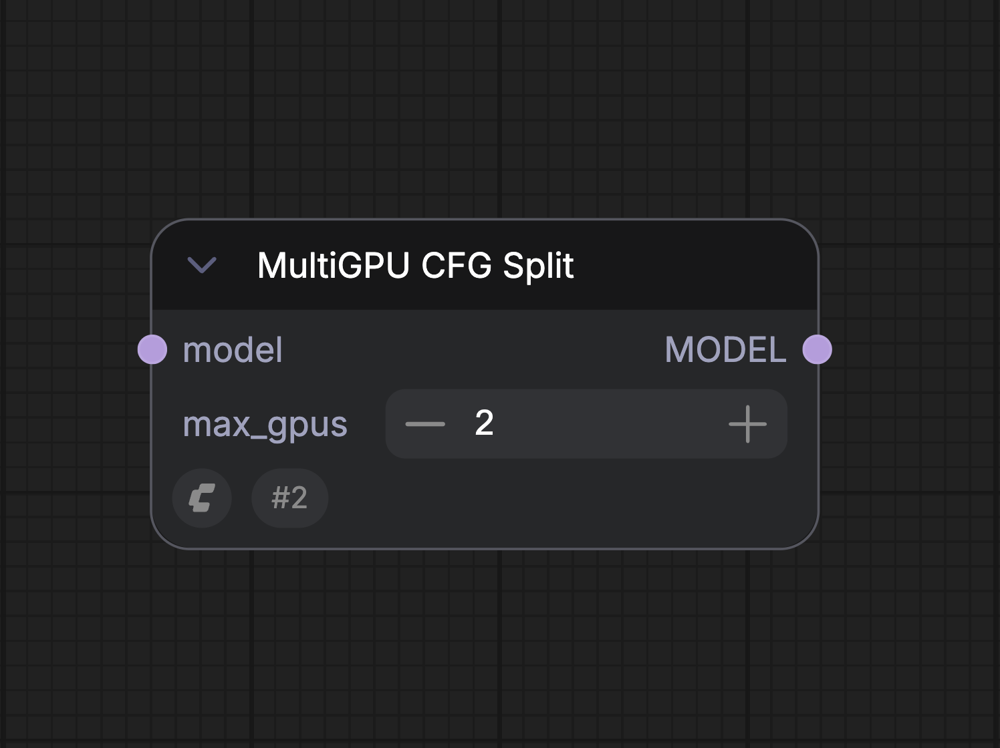
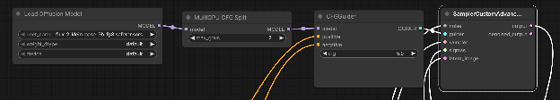
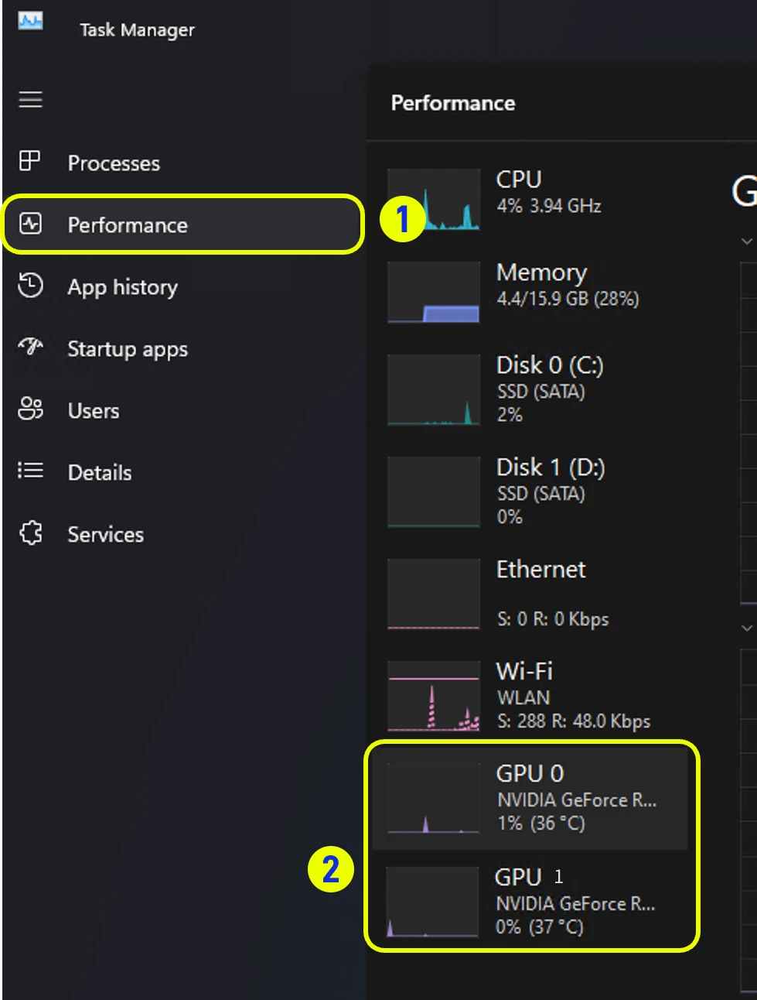

# MultiGPU_WorkUnits

## Panoramica:

Il nodo MultiGPU CFG Split consente l'elaborazione della diffusione utilizzando più GPU installate nello stesso sistema. I risultati prestazionali dipendono dal flusso di lavoro, ma sono stati misurati miglioramenti fino a 1,95x in flussi di lavoro comuni.

## Dettagli chiave:

La combinazione di tipi di GPU diversi non è supportata; le GPU installate devono essere identiche (ad es. 2x 5090, o 2x 5080, ecc.)

ComfyUI rileverà automaticamente più GPU installate all'avvio.

## GPU supportate:

Qualsiasi configurazione dual GPU omogenea con architettura Ampere+ (ad es. 2 x 3090 o 2 x RTX6000 Pro)

## Modelli supportati:

* LTX-2.3  
* WAN 2.2  
* FLUX.2 Klein \- Base Versions  
* Z-Image  
* Stable Diffusion 3.5 Large  
* Hunyuan Video  
* Qwen-Image-Edit-2511  
* Hunyuan-3D-v2.1  
* SDXL

## Input

| Parametro | Descrizione | Tipo di dati | Obbligatorio | Intervallo |
| --- | --- | --- | --- | --- |
| `model` | Il modello da preparare per la suddivisione CFG multi-GPU prima del campionamento. | MODEL | Sì | N/A |
| `max_gpus` | Il numero massimo di GPU identiche da utilizzare per la suddivisione del carico di lavoro. Impostare questo valore al numero di GPU corrispondenti installate nel sistema. | INT | Sì | Minimo: 1 Passo: 1 Predefinito: 2 |

## Output

| Nome output | Descrizione | Tipo di dati |
| --- | --- | --- |
| `MODEL` | Il modello preparato per la suddivisione CFG multi-GPU, pronto per il campionamento accelerato. | MODEL |

## Nodo:

  
Il campo max\_gpus deve essere impostato al numero massimo di GPU identiche installate nel sistema. 

**Posizionamento del nodo:**  Il nodo MultiGPU CFG Split deve essere posizionato tra il nodo Model Load e il nodo Sampling. Se altri nodi sono collegati all'output del modello del nodo di caricamento del modello, il nodo MultiGPU CFG deve essere l'ultimo nodo nella catena prima del nodo Sampling.

**Requisiti del flusso di lavoro:** Il nodo funziona suddividendo il flusso di lavoro di diffusione a livello di CFG; per questo motivo, il CFG nel flusso di lavoro deve essere maggiore di CFG=1. I flussi di lavoro distillati che richiedono un CFG \=1 non mostreranno alcun beneficio prestazionale quando si utilizza il nodo MultiGPU CFG Split per l'esecuzione su più GPU. 

## Verifica dell'utilizzo multi-GPU

Quando si esegue un flusso di lavoro con MultiGPU CFG Split abilitato, è possibile controllare il Task Manager di Windows e selezionare la categoria prestazioni  
  
  
Dovresti vedere attività su entrambe le GPU installate mentre il sampler è in esecuzione nel flusso di lavoro. 

## Flusso di lavoro multi-GPU di esempio: (Wan 2.2 FP8)

[Flusso di lavoro di esempio (Wan 2.2 FP8)](https://raw.githubusercontent.com/Comfy-Org/embedded-docs/refs/heads/main/comfyui_embedded_docs/docs/MultiGPU_WorkUnits/asset/video_wan2_2_14B_t2v_mGPU.json)

> Questa documentazione è stata generata dall'IA. Se trovi errori o hai suggerimenti per migliorarla, sentiti libero di contribuire! [Modifica su GitHub](https://github.com/Comfy-Org/embedded-docs/blob/main/comfyui_embedded_docs/docs/MultiGPU_WorkUnits/it.md)

---
**Source fingerprint (SHA-256):** `7293ee785e29aea9a1a70a10444b99e89fb23c866505628ec57c209a2b8aaee0`
