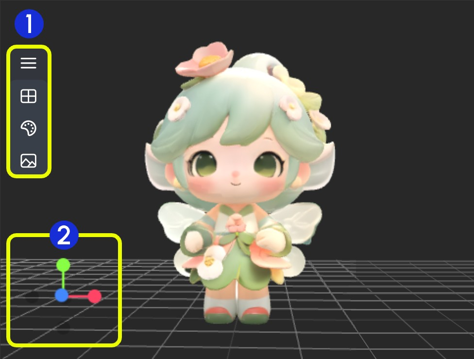

# תצוגה מקדימה של 3D והנפשה (מיושן)

צומת Preview3D משמשת בעיקר לתצוגה מקדימה של פלטי מודלים תלת-ממדיים. צומת זו מקבלת שני קלטים: האחד הוא `camera_info` מצומת Load3D, והשני הוא הנתיב לקובץ המודל התלת-ממדי. נתיב קובץ המודל חייב להיות ממוקם בתיקיית `ComfyUI/output`.

**פורמטים נתמכים**
נכון לעכשיו, צומת זו תומכת במספר פורמטים של קבצים תלת-ממדיים, כולל `.gltf`, `.glb`, `.obj`, `.fbx`, ו-`.stl`.

**העדפות צמתי 3D**
ניתן להגדיר חלק מההעדפות הקשורות לצמתי 3D בתפריט ההגדרות של ComfyUI. אנא עיין בתיעוד הבא עבור ההגדרות המתאימות:
[תפריט הגדרות](https://docs.comfy.org/interface/settings/3d)

## קלטים

| שם פרמטר | תיאור | סוג |
| --- | --- | --- |
| camera_info | מידע מצלמה | LOAD3D_CAMERA |
| model_file | נתיב קובץ המודל תחת `ComfyUI/output/` | LOAD3D_CAMERA |

## תיאור אזור הקנבס

נכון לעכשיו, הצמתים הקשורים ל-3D בחזית ComfyUI חולקים אותו רכיב קנבס, כך שהפעולות הבסיסיות שלהם זהות ברובן למעט כמה הבדלים פונקציונליים.

> התוכן והממשק הבאים מבוססים בעיקר על צומת Load3D. אנא עיין בממשק הצומת בפועל עבור תכונות ספציפיות.

אזור הקנבס כולל פעולות תצוגה שונות, כגון:

- הגדרות תצוגה מקדימה (רשת, צבע רקע, תצוגה מקדימה)
- שליטת מצלמה: FOV, סוג מצלמה
- עוצמת תאורה גלובלית: התאמת תאורה
- ייצוא מודל: תומך בפורמטים `GLB`, `OBJ`, `STL`
- וכו'.

1. מכיל מספר תפריטים ותפריטים מוסתרים של צומת Load 3D
2. ציר פעולות תצוגת 3D

### 1. פעולות תצוגה

<video controls width="640" height="360">
  <source src="https://raw.githubusercontent.com/Comfy-Org/embedded-docs/refs/heads/main/comfyui_embedded_docs/docs/Load3D/asset/view_operations.mp4" type="video/mp4">
  הדפדפן שלך לא תומך בהפעלת וידאו.
</video>

פעולות שליטת תצוגה:

- לחיצה שמאלית + גרירה: סיבוב התצוגה
- לחיצה ימנית + גרירה: הזזת התצוגה
- גלגלת אמצעית או לחיצה אמצעית + גרירה: התקרבות/התרחקות
- ציר קואורדינטות: החלפת תצוגות

### 2. פונקציות תפריט שמאל

באזור התצוגה המקדימה, חלק מתפריטי פעולות התצוגה מוסתרים בתפריט. לחץ על כפתור התפריט כדי לפתוח תפריטים שונים.

- 1. סצנה: מכיל רשת חלון תצוגה מקדימה, צבע רקע, הגדרות תמונה ממוזערת
- 2. מודל: מצב רינדור מודל, חומר מרקם, הגדרות כיוון מעלה
- 3. מצלמה: החלפה בין תצוגות אורתוגרפיות ופרספקטיביות, קביעת זווית פרספקטיבה
- 4. תאורה: עוצמת תאורה גלובלית של הסצנה
- 5. ייצוא: ייצוא מודל לפורמטים אחרים (GLB, OBJ, STL)

#### סצנה

תפריט סצנה מספק פונקציות בסיסיות להגדרת סצנה:

1. הצג/הסתר רשת
2. קביעת צבע רקע
3. לחץ להעלאת תמונת רקע
4. הסתר תמונה ממוזערת של תצוגה מקדימה

#### מודל

תפריט מודל מספק פונקציות הקשורות למודל:

1. **כיוון מעלה**: קביעת הציר שהוא כיוון המעלה עבור המודל
2. **מצב חומר**: החלפת מצבי רינדור המודל - מקורי, נורמל, מסגרת תיל, קווי מתאר

#### מצלמה

תפריט זה מספק החלפה בין תצוגות אורתוגרפיות ופרספקטיביות, והגדרות גודל זווית פרספקטיבה:

1. **מצלמה**: החלפה מהירה בין תצוגות אורתוגרפיות ופרספקטיביות
2. **FOV**: התאמת זווית FOV

#### תאורה

דרך תפריט זה, ניתן להתאים במהירות את עוצמת התאורה הגלובלית של הסצנה

#### ייצוא

תפריט זה מספק יכולת להמיר ולייצא פורמטים של מודלים במהירות

> מסמך זה נוצר על ידי בינה מלאכותית. אם מצאתם שגיאות או שיש לכם הצעות לשיפור, אתם מוזמנים לתרום! [עריכה ב-GitHub](https://github.com/Comfy-Org/embedded-docs/blob/main/comfyui_embedded_docs/docs/Preview3D/he.md)
